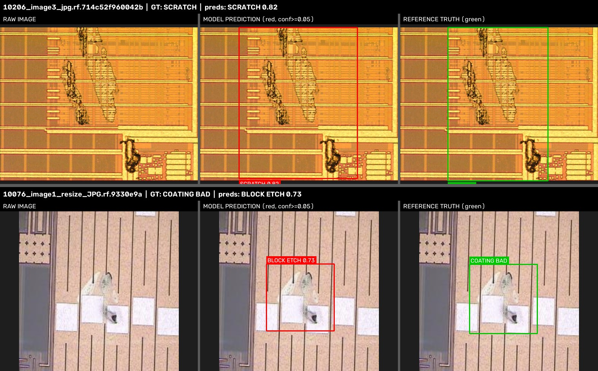

# Wafer defect inspection

A small YOLOv8n object detector for optical wafer-surface images. The repository contains trained weights, a CPU demo, seven test images with reference labels, and side-by-side visual comparisons.

## Try it locally

Use Python 3.12 and a virtual environment. Install matching CPU builds of PyTorch and torchvision before Ultralytics:

```bash
python3.12 -m venv .venv
. .venv/bin/activate
python -m pip install torch torchvision --index-url https://download.pytorch.org/whl/cpu
python -m pip install ultralytics==8.4.216 opencv-python pillow
python predict_demo.py
python scripts/compare_cards.py
```

Predictions and comparison cards are written to `out/`. The cards show the full raw image, model predictions in red, and reference boxes in green. The comparison script uses a low **0.05** confidence threshold to display weak predictions; this is not a validated operating threshold.



## Results and limitations

The detector was trained for 100 epochs at 640 px, batch 16, seed 42. The publisher-provided split contains 3,172 training, 907 validation and 452 test images. Test metrics for the selected checkpoint:

| Class | Precision | Recall | mAP50 | mAP50–95 |
|---|---:|---:|---:|---:|
| Overall | 0.690 | 0.676 | 0.687 | 0.428 |
| BLOCK ETCH | 0.709 | 0.707 | 0.734 | 0.447 |
| COATING BAD | 0.567 | 0.449 | 0.519 | 0.395 |
| PARTICLE | 0.694 | 0.850 | 0.737 | 0.433 |
| PIQ PARTICLE | 0.603 | 0.710 | 0.729 | 0.459 |
| PO CONTAMINATION | 0.776 | 0.587 | 0.668 | 0.432 |
| SCRATCH | 0.800 | 0.831 | 0.853 | 0.530 |
| SEZ BURNT | 0.682 | 0.596 | 0.569 | 0.298 |

- These are experimental results, not proof of fab-scale or physical-wafer camera performance. No group-independent or cross-fab generalisation is established.
- The source export had no empty label files, so clean-image false positives were not tested on a negative set. A missing prediction does **not** establish a clean wafer.
- Some classes are weak; SEZ BURNT has only 18 test instances. Predictions can be confidently wrong.
- `docs/evidence-schema.md` is an unimplemented design draft. Its thresholds and example values are illustrative, not calibrated or validated.

## Data and attribution

The primary dataset and the seven included demo images are from [Wafer Defect by Wafer, Roboflow Universe](https://universe.roboflow.com/wafer-irhuv/wafer-defect-rv1vx), licensed [CC BY 4.0](https://creativecommons.org/licenses/by/4.0/). Labels were converted from four-corner oriented boxes to enclosing axis-aligned boxes; comparison images are annotated derivatives. Dataset version, checksum and split counts are recorded in `docs/PROVENANCE.json`.

The `data/` directory also contains the [Quadbits compiled dataset](https://github.com/SanskaarUndale21/deeptech2026-Quadbits). Its repository does not declare a license; verify rights before further sharing or use. It is classification data without detection boxes, and some images are wafer maps rather than optical images. An initial exact perceptual-hash scan found many possible overlaps with the primary dataset, including its test split; these are candidate matches, not independently verified duplicates. Do not merge the sets without checking provenance, modality, labels and leakage.

`model/best.pt` is the trained PyTorch checkpoint; `model/best.onnx` is an ONNX export. The demo uses Ultralytics; its separate licensing terms apply. Check the dataset and dependency terms before redistribution or commercial use. No project source-code license is specified here.
